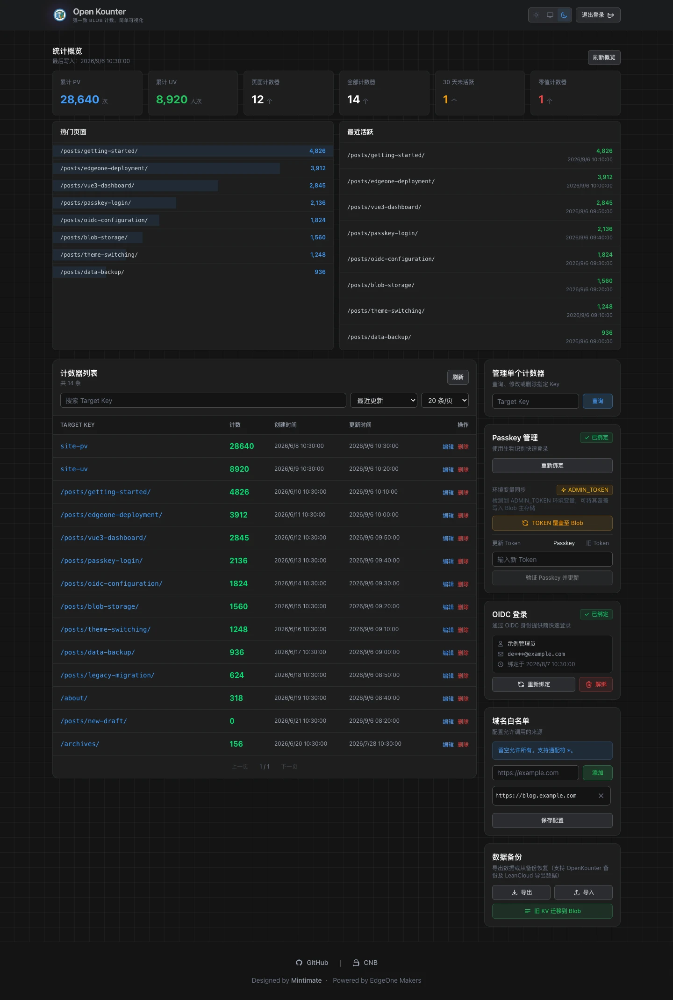
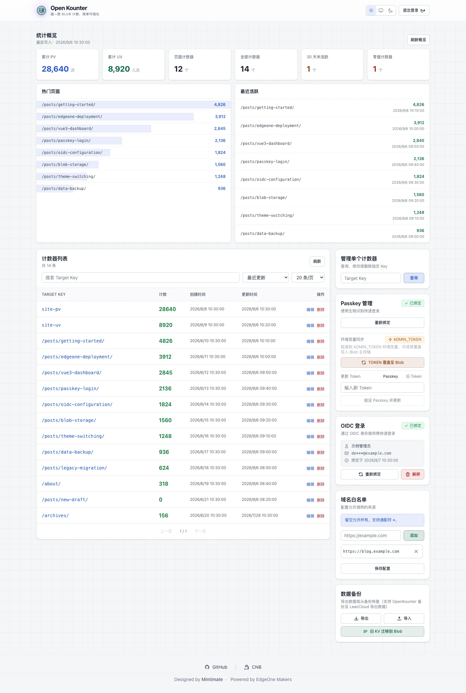
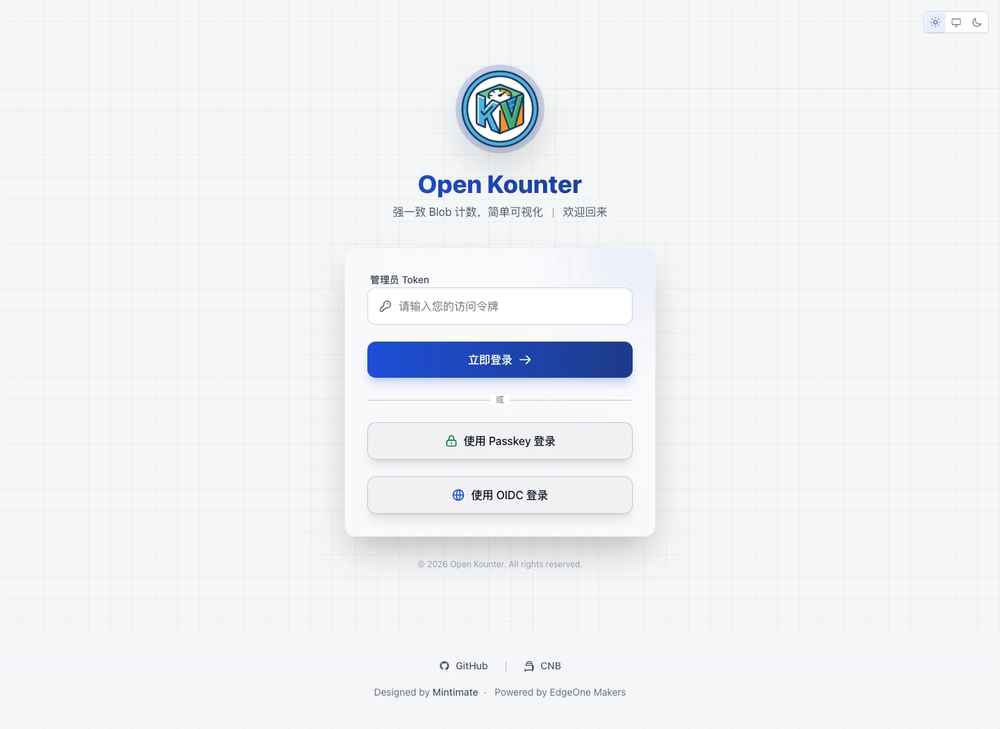

<p align="center">
  
</p>

<h1 align="center">Open Kounter</h1>

<p align="center">
  开源、自托管的网站 PV / UV 计数器<br>
  基于 EdgeOne Makers / Pages Functions 与 Blob，可替代 LeanCloud 访客统计
</p>

<p align="center">
  <a href="#快速开始"><strong>快速部署</strong></a> ·
  <a href="docs/integration.md"><strong>网站接入</strong></a> ·
  <a href="https://cnb.cool/Mintimate/tool-forge/open-kounter">CNB 主仓库</a> ·
  <a href="https://github.com/Mintimate/open-kounter">GitHub 镜像</a>
</p>

<p align="center">
  <a href="#功能概览">主要功能</a> ·
  <a href="#界面预览">界面预览</a> ·
  <a href="#快速开始">快速开始</a> ·
  <a href="docs/deployment.md#环境变量">配置说明</a> ·
  <a href="docs/api.md">API 文档</a> ·
  <a href="docs/maintenance.md">维护升级</a> ·
  <a href="docs/development.md">开发指南</a>
</p>

## 功能概览

| 功能 | 说明 |
|---|---|
| 访问计数 | 单个 / 批量递增，支持站点和页面自定义 Target Key |
| 统计概览 | 累计 PV / UV、热门页面、最近活跃及零值计数器 |
| 计数管理 | 搜索、排序、分页、修改和删除 |
| 登录认证 | Token、Passkey、OIDC，按已配置能力显示登录入口 |
| 数据维护 | JSON 导入导出、域名白名单、旧 KV 迁移 |
| 界面主题 | 亮色 / 跟随系统 / 暗色，适配桌面和移动端 |

UV 由接入端按浏览器本地记录去重，不代表跨设备独立用户；详见 [计数与访客去重](docs/integration.md#计数与访客去重)。

## 快速开始

选择以下任意一种方式部署到 EdgeOne Makers：

### 方式一：Git Clone + CLI

本地准备 Git 和 Node.js 22，克隆后通过 CLI 登录并部署：

```bash
git clone https://cnb.cool/Mintimate/tool-forge/open-kounter.git
cd open-kounter
npm ci
npm install -g edgeone
# 这里使用 login 模式，你也可以使用 token 模式
edgeone login
edgeone makers deploy -n open-kounter
```

项目名可修改；CLI 从仓库根目录自动构建并部署。已有同名的直接上传项目会更新生产部署，详见 [CLI 部署说明](docs/deployment.md#git-clone--cli)。

### 方式二：CNB Fork 后点击部署按钮

1. **先在 CNB 上 Fork** [本仓库](https://cnb.cool/Mintimate/tool-forge/open-kounter)。
2. 进入**自己 Fork 后的 CNB 仓库**，在「代码」→ `main` 分支页面点击 **部署到 EdgeOne Makers**。
3. 填写自己的 Makers Token 和项目名（默认 `open-kounter`），启动生产部署。

仅在 GitHub 上 Fork 不会出现 CNB 的部署按钮。Token 为普通文本输入，请在自己信任的仓库中填写；已有同名项目会更新，详见 [CNB 按钮部署说明](docs/deployment.md#cnb-按钮部署)。

### 方式三：EdgeOne Makers 一键部署按钮

点击下方按钮，在 EdgeOne Makers 控制台按提示导入仓库并部署。此入口使用 GitHub 镜像，建议先在 GitHub 上 Fork，并确认控制台中的仓库地址。详见 [Makers 按钮部署说明](docs/deployment.md#edgeone-makers-按钮部署)。

[](https://console.cloud.tencent.com/edgeone/pages/new?repository-url=https://github.com/Mintimate/open-kounter)

三种方式使用相同构建配置：**Vite · Node.js 22 · `npm run build:makers` · 输出目录 `dist`**。

部署完成后，在控制台开启 **Blob 存储**，访问项目网址创建管理员 Token（已预设 `ADMIN_TOKEN` 时直接登录），再按 [网站接入与 AI 迁移](docs/integration.md) 接入统计。完整配置见 [部署指南](docs/deployment.md)。

## 界面预览

以下为实际界面截图，统计值、页面路径和账号信息均为示例数据。



<details>
<summary>亮色仪表盘与登录页</summary>





</details>

## 文档

| 文档 | 内容 |
|---|---|
| [部署与配置](docs/deployment.md) | Git Clone + CLI、CNB Fork 按钮、Makers 按钮及部署后配置 |
| [网站接入与 AI 迁移](docs/integration.md) | 适配器行为、UV 去重和 LeanCloud 迁移 Skill |
| [API 参考](docs/api.md) | 请求参数、响应示例、鉴权、OIDC 和 Passkey |
| [维护与升级](docs/maintenance.md) | 原生定时清理、旧版本升级及数据维护 |
| [开发指南](docs/development.md) | 主仓库工作流、目录职责、本地验证和文档维护 |
| [Blob 并发与恢复设计](docs/blob-concurrency.md) | 存储边界、遗留锁恢复与后续方案 |

开发和 PR 请提交到 **CNB 主仓库**。GitHub 的 `main` 由 CNB 单向同步，详细约定见 [开发指南](docs/development.md#主仓库与镜像)。

项目背景：[LeanCloud 遗憾谢幕：基于 EdgeOne Blob 打造高性能 PV/UV 访客统计](https://www.mintimate.cn/2026/02/14/openKounter/)。部署和接口行为以当前仓库文档与代码为准。

## 许可证

[MIT License](LICENSE)
